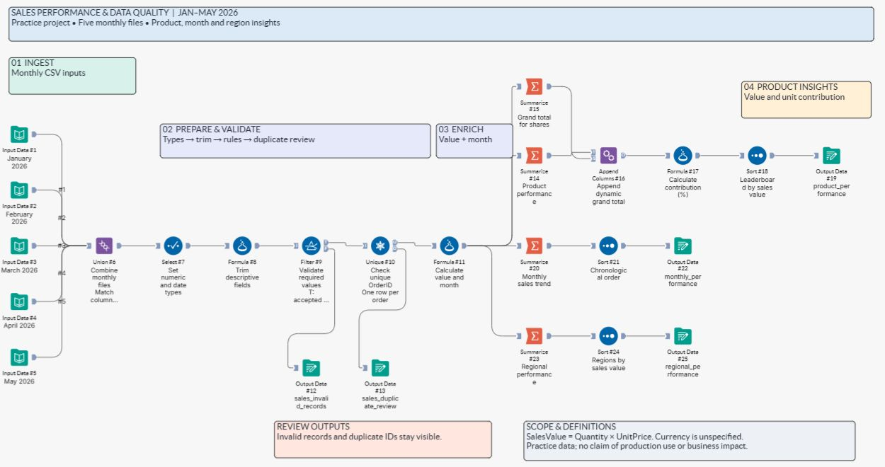
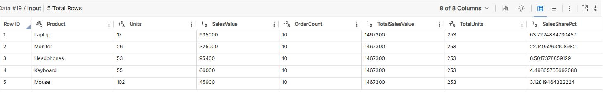

# Alteryx Sales Performance & Data Quality

A first Alteryx learning project expanded from a five-file product-quantity summary into a repeatable sales-performance workflow with validation, duplicate review, dynamic contribution percentages, and product/month/region outputs.

## Project at a glance

- **Platform:** Alteryx Designer Cloud, Standard mode
- **Period:** January–May 2026
- **Source:** five user-supplied practice CSV files
- **Workflow:** 25 processing/output tools and 7 canvas comments
- **Full cloud run:** successful on 12 October 2026 (job 4784772)
- **Scope:** a learning project; the data do not represent a real business

## What the workflow does

1. Combines the five monthly files with Union by column name.
2. Converts order IDs, quantities, prices and dates to appropriate types.
3. Trims product, region and salesperson text.
4. Validates required values, positive quantities and nonnegative prices.
5. Checks duplicate OrderIDs and keeps review records in separate outputs.
6. Calculates `SalesValue = Quantity × UnitPrice` and an order-month field.
7. Produces product, monthly and regional summaries.
8. Appends a separately calculated grand total to the product summary and derives sales-value and unit shares, with zero-total guards.
9. Sorts the product and region leaderboards by sales value and the monthly output chronologically.

## Findings from the practice data

| Check | Result |
|---|---:|
| Input order records | 50 |
| Accepted records | 50 |
| Invalid records | 0 |
| Duplicate OrderIDs | 0 |
| Total units | 253 |
| Total sales value | 1,467,300 |
| Product / month / region groups | 5 / 5 / 4 |

Currency is unspecified in the source files.

**Mouse leads by volume:** 102 units, or 40.3% of units sold.  
**Laptop leads by value:** 935,000, or 63.7% of sales value.

## Repository contents

- `workflow/sales-performance.canvas.json` — the complete saved canvas definition in Alteryx's clipboard format, with personal workspace bindings removed.
- `data/` — the five original monthly practice CSV files.
- `results/` — independently reproduced reference outputs, checked against Alteryx's preview results. The invalid and duplicate reference files contain headers only because both counts are zero.
- `images/` — screenshots of the actual Alteryx workflow and product-results preview.
- `docs/` — workflow restoration instructions, validation details and a LinkedIn draft.

## Restore the workflow

This repository includes a **clipboard-format canvas definition**, rather than a native Library-download export. The Library download reported success, but the browser connection did not return the file. The definition was copied directly from the saved, successfully executed workflow; it is not a screenshot-only representation.

1. Download `workflow/sales-performance.canvas.json` and open it as plain text.
2. Copy its entire JSON content, without adding formatting or code fences.
3. Create an empty **Standard-mode workflow** in Alteryx Designer Cloud.
4. Click an empty part of the canvas and paste with **Ctrl+V**.
5. Reconnect the five Input Data tools to the CSVs in `data/`, matching each month label.
6. Configure the five Output Data tools in your own Alteryx Data Storage location.
7. Run the workflow and compare your results with `results/`.

Do not use this clipboard-format file with **Library → Upload**; that uploader expects Alteryx's native export format. Workspace dataset IDs and storage paths were intentionally cleared, so source and output connections must be configured before running.

See [restoration instructions](docs/RESTORE.md) and [validation details](docs/VALIDATION.md).

## Assumptions and limits

- Each row is one order in this practice dataset. For data with multiple lines per order, use an order-line key when reviewing duplicates.
- Quantity and UnitPrice are integers in these source files. Adjust types and precision for datasets with fractional quantities or prices.
- Sales value does not include taxes, discounts, returns, or costs; those fields are not supplied.
- The clean source data produced zero exceptions. Broader malformed-data and production-environment testing is outside this learning project's scope.

## Alteryx reference

Alteryx documents native workflow export/import separately from canvas clipboard operations: [Cloud workflow import and export](https://help.alteryx.com/aac/en/platform/library-for-assets/asset-types.html) and [Designer Cloud keyboard shortcuts](https://help.alteryx.com/aac/pt/designer-experience/get-started-with-workflows/keyboard-shortcuts-in-designer-cloud.html).
